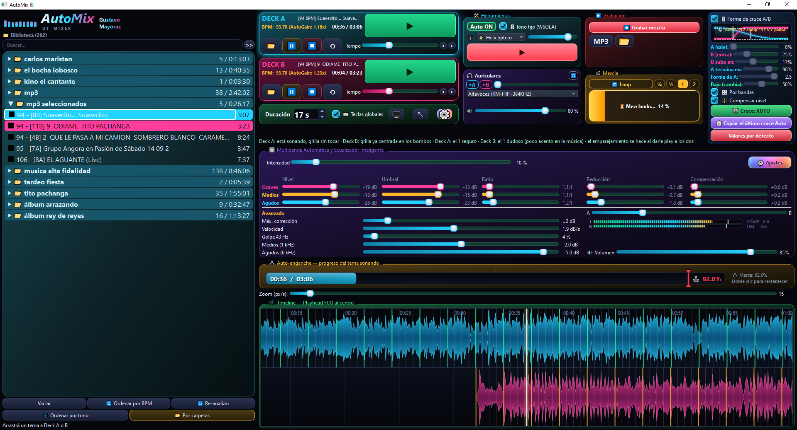

# AutoMix — mezclador DJ automático de dos decks

**AutoMix** es un mezclador DJ de escritorio hecho con **Python, PySide6 y librosa**. Tiene dos decks con crossfader, **mezcla automática (auto-DJ)**, **beat-matching** por BPM y tonalidad, y un **cruce A/B inteligente por bandas**: el programa analiza cada par de temas y diseña su propio crossfade (duración, entrada del tema que viene, salida del que sale y traspaso de graves en la línea del compás). Pensado para Windows.

Palabras clave: DJ, auto DJ, automix, mezcla automática, crossfade, beatmatching, BPM, mezclador de dos decks, Python, PySide6, librosa.

## Qué lo hace diferente
AutoMix no solo cambia de tema: **escucha cada par de canciones y decide cómo mezclarlas**, como lo haría un DJ con oído, y lo hace sin que toques nada.

### 🤖 Mezcla inteligente
- **Cruce Auto que diseña cada mezcla a medida**: analiza voz o melodía, bajo, compases y frases de los dos temas y define la duración en compases, cuándo entra el que viene, cómo se va el que sale y en qué compás se traspasa el bajo. Cada par de temas recibe un cruce distinto.
- **Cruce por bandas con traspaso de graves en el compás**: el tema entrante entra al 100 % y el bombo y el bajo (menos de 150 Hz, filtro Linkwitz-Riley) pasan de un tema al otro en la línea del compás, sin empaste de graves ni choques de bombos.
- **Auto-DJ de punta a punta**: con una marca roja ajustable sobre el progreso del tema sonando, la mezcla arranca exactamente en ese punto; también se dispara a mano con F2.
- **Fundido elegante para temas incompatibles**: si los BPM no son compatibles, en vez de forzar un cruce el tema que suena baja de volumen y entra el siguiente. La forma de ese fundido se dibuja arrastrando puntos con el mouse.
- **Cruce Manual a tu gusto**: la forma del cruce A/B se ve dibujada en vivo y se ajusta con deslizadores (A, B, B sube en, A termina en, Forma de A y Bajo); con un clic copiás el último cruce que hizo el Auto para dejarlo fijo.

### 🎯 Análisis automático de la biblioteca
- **BPM y tonalidad (rueda de Camelot)** de cada tema, con la lista ordenándose sola mientras analiza: por BPM, por tono o por carpetas, o en cadena armónica para que los temas encajen entre sí.
- **Auto-grilla**: corrige los BPM doble/mitad respecto del otro tema y centra la grilla de compases sobre los bombos, sin arrastrar nada a mano. **AutoGain** que empareja el volumen de cada tema al cargarlo.
- **Sincronía de dos decks**: tempo compartido y fase emparejada con estiramiento de tiempo **WSOLA**, que cambia la velocidad sin cambiar el tono.

### 🎛 Sonido profesional
- **Ecualizador multibanda inteligente** (graves, medios y agudos) con nivel, umbral, ratio, reducción y compensación por banda, y controles de golpe a 43 Hz, medios y agudos.
- **Compensación de nivel** cuando suenan los dos temas a la vez, y **limitador por ganancia** que evita el recorte de la onda.
- **Auriculares con preescucha (PFL)**: escuchás cualquiera de los dos decks por otra placa de sonido sin mandarlo a los parlantes.
- **Loops de 1/4, 1/2, 1 o 2 compases** pegados a la grilla, para el clásico "chiqui-chiqui" mientras entra el otro tema.

### 🎬 Para el directo
- **Timeline en vivo** con la forma de onda de los dos temas, playhead fijo al centro, marcas de compás y zoom.
- **45 efectos de sonido generados por código** (aplausos, ovación, sirenas, risers, impactos, scratch, campanas, láser y más) que se suman encima de la mezcla, con su propio volumen.
- **Grabación de la mezcla** en MP3 (320 kbps) o WAV sin pérdida, con cierre suave (rampa de 15 s y 3 s de silencio) para que no corte en seco.
- **Teclas globales** (F2 mezcla, flechas para el volumen) que funcionan aunque el programa esté en segundo plano.
- **Interfaz que se adapta a la pantalla**: se escala sola con el tamaño de la ventana y arranca ordenada en la esquina.

## Instalación

### Windows, fácil (no necesita Python)
1. Bajá [`instalador/AutoMix-Setup.exe`](instalador/AutoMix-Setup.exe) (botón de descarga en esa página).
2. Hacé doble clic. Baja solo todo lo necesario (Python 3.14 propio y las librerías, unos 600 MB a 1 GB la primera vez) y abre AutoMix.
3. Después se abre desde el acceso directo del Escritorio. Se desinstala desde *Aplicaciones y características*.

Si Windows muestra "Windows protegió su PC", tocá *Más información* → *Ejecutar de todas formas* (el programa no está firmado).

### Desde el código
    pip install -r requirements.txt
    python AutoMix.py

Requiere Python 3.10+.

## Datos locales
El programa crea una carpeta `cache/` junto al script (configuración, biblioteca y análisis). No se sube al repositorio.

## Créditos
Desarrollado por Gustavo con la ayuda de [Claude](https://claude.ai) (Anthropic), la herramienta de IA que se usó para programarlo.
